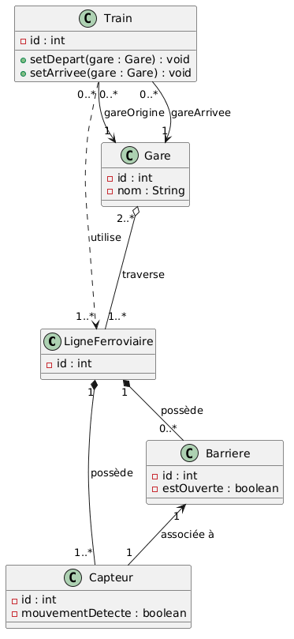
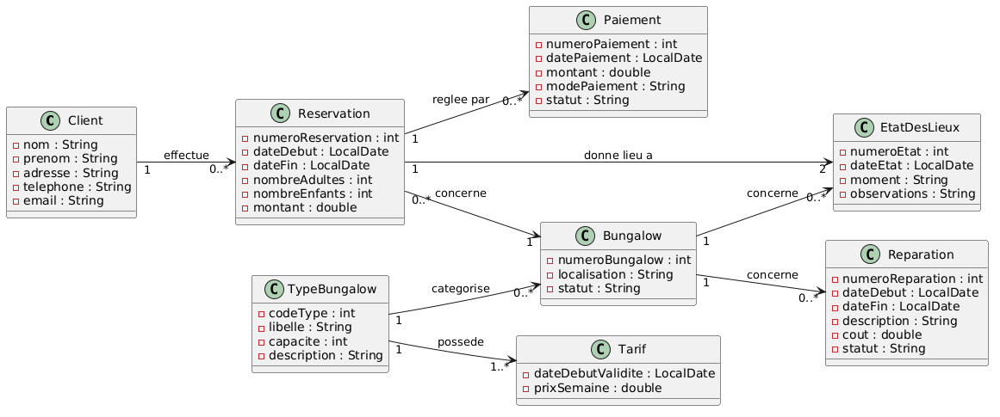

# TP 5 : Diagrammes de cas d’utilisation et diagrammes de classes
## Ex. 1 Simulation d’un réseau ferroviaire
```java
@startuml

class LigneFerroviaire {
    - id : int
}

class Gare {
    - id : int
    - nom : String
}

class Train {
    - id : int
    + setDepart(gare : Gare) : void
    + setArrivee(gare : Gare) : void
}

class Capteur {
    - id : int
    - mouvementDetecte : boolean
}

class Barriere {
    - id : int
    - estOuverte : boolean
}


Gare "2..*" o--- "1..*" LigneFerroviaire : traverse
Train "0..*" --> "1" Gare : gareOrigine
Train "0..*" --> "1" Gare : gareArrivee
Train "0..*" ...> "1..*" LigneFerroviaire : utilise
LigneFerroviaire "1" *-- "1..*" Capteur : possède
LigneFerroviaire "1" *-- "0..*" Barriere : possède
Barriere "1" <-- "1" Capteur : associée à

@enduml
```


## Ex. 2 Location de bungalows
```java
@startuml

class Client {
    - nom : String
    - prenom : String
    - adresse : String
    - telephone : String
    - email : String
}

class Reservation {
    - numeroReservation : int
    - dateDebut : LocalDate
    - dateFin : LocalDate
    - nombreAdultes : int
    - nombreEnfants : int
    - montant : double
}

class Bungalow {
    - numeroBungalow : int
    - localisation : String
    - statut : String
}

class TypeBungalow {
    - codeType : int
    - libelle : String
    - capacite : int
    - description : String
}

class Tarif {
    - dateDebutValidite : LocalDate
    - prixSemaine : double
}

class Paiement {
    - numeroPaiement : int
    - datePaiement : LocalDate
    - montant : double
    - modePaiement : String
    - statut : String
}

class EtatDesLieux {
    - numeroEtat : int
    - dateEtat : LocalDate
    - moment : String
    - observations : String
}

class Reparation {
    - numeroReparation : int
    - dateDebut : LocalDate
    - dateFin : LocalDate
    - description : String
    - cout : double
    - statut : String
}

Client "1" --> "0..*" Reservation : effectue
Reservation "0..*" --> "1" Bungalow : concerne
TypeBungalow "1" --> "0..*" Bungalow : categorise
TypeBungalow "1" --> "1..*" Tarif : possede
Reservation "1" --> "0..*" Paiement : reglee par
Bungalow "1" --> "0..*" EtatDesLieux : concerne
Reservation "1" --> "2" EtatDesLieux : donne lieu a
Bungalow "1" --> "0..*" Reparation : concerne

@enduml
```


## Ex. 3 Logiciel d’inscription à l’I.U.T.
